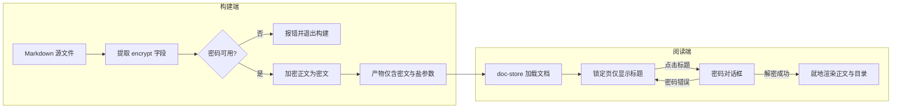
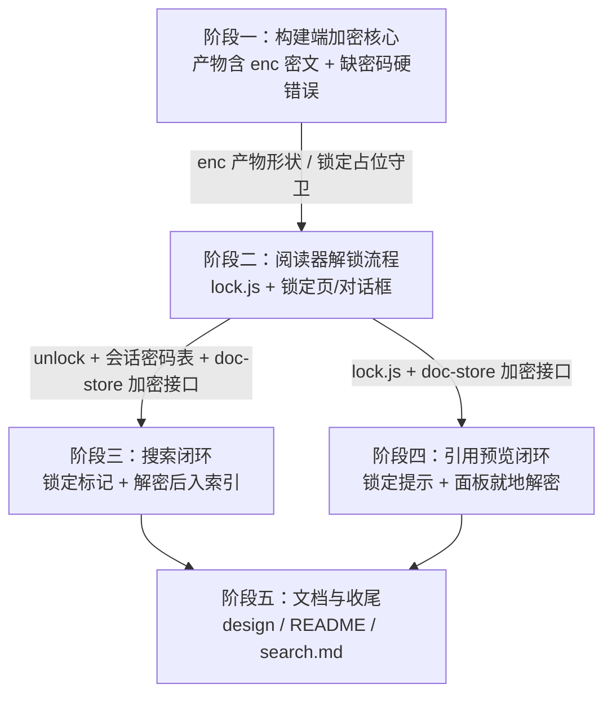

# TODO — 文章级加密功能实施计划

> 状态：计划已定稿，待实施　|　日期：2026-11-13　|　分支：`feature/encrypt`
>
> 本文件是加密功能的分阶段实施计划。每个阶段可独立验收（构建或阅读行为可见、测试与质量门可独立通过）。
> 实施过程中如设计偏离本文件，须先更新本文件再动代码。

## 1. 背景与已定决策

### 1.1 需求清单与落点映射

| # | 需求 | 实现落点 |
| --- | --- | --- |
| 1 | 加密针对文章本身，仅对声明加密的文章加密 | Front Matter 单字段 `encrypt`；构建期仅密封声明了加密的 `DocModel` |
| 2 | 文章携带密码用文章密码，否则用全局密码 | 密码解析顺序：`encrypt: "密码"`（文章密码）→ 全局密码（三源） |
| 3 | 全局密码可经环境变量 / 命令行 / 配置文件设置 | `--password` / `WIKICC_PASSWORD` / `.wikicc.json` `password`，优先级 CLI > env > file |
| 4 | 要求加密但无任何密码时，报错并退出构建 | `Error::InvalidInput`，退出码 1，消息含文档 id |
| 5 | 加密页面仅显示标题；点击标题弹对话框解密后查看 | `app.js` 锁定页 + 新模块 `lock.js` 模态对话框 |
| 6 | 真实加密，无法绕过（含文本编辑器打开 HTML） | AES-256-GCM + PBKDF2；产物仅含密文与盐参数，无明文无密码 |
| 7 | 加密内容不可搜；解密后才可搜（标题例外，见 1.2） | 构建期语料裁剪（仅标题）+ 解密成功后动态加入索引 |
| 8 | 引用加密文章 block 时预览提示加密，预览内可就地解密 | `preview.js` / `preview-view.js` 加密分支 + 面板内解锁表单 |
| 9 | 密码不得包含在产物内 | 产物仅含 `{v, kdf, iters, salt, nonce, ct}`；验收含"产物无密码明文"字符串断言 |

### 1.2 已拍板设计（用户确认，不再重议）

- **单一字段**：`encrypt: true | "密码"` —— `true` 用全局密码加密；`"密码"` 用文章特定密码加密；不写或 `false` 表示不加密。
- **标题公开可搜**：标题是公开信息（锁定页本来就显示标题）。解密前按标题可命中，命中后跳转锁定页，用户就地解密后再看内容；解密前正文/标题外的内容一律不可搜。
- **会话内记忆**：同一页面会话内解密过的文章不再重复询问；刷新或关闭页面后需重新输入；密码不写入 `localStorage` 等任何持久存储（纯内存）。

## 2. 总体方案

### 2.1 加密算法与参数

- **算法**：AES-256-GCM（认证加密：解密失败即密码错误或密文被篡改，无需额外校验字段）。
- **密钥派生**：PBKDF2-HMAC-SHA256，600,000 次迭代（OWASP 推荐），输出 256-bit 密钥。
- **逐文档参数**：每次构建为每个加密文档生成新的 16 字节随机 salt 与 12 字节随机 nonce。
- **AAD 绑定**：密文以文档 id（UTF-8 字节）作为 AES-GCM `additionalData`，密文不可跨文档搬运。
- **明文形状**：文档内容的 canonical JSON `{html, toc, blocks, text}` —— 目录与分块一并加密，防章节结构泄漏；标题保持公开。
- **实现选型**：
  - Rust 构建端：新增纯 Rust 依赖 `aes-gcm` 0.10 + `pbkdf2` 0.12（hmac/sha2 随附；`sha2`、`base64` 已是现有依赖）；随机数经 `rand_core`/`getrandom`。
  - 浏览器端：Web Crypto（`crypto.subtle` 的 PBKDF2 + AES-GCM 原生支持），**不新增 npm 依赖**；新 JS 模块被 `main.js` 引用后由 `build.rs` 的 esbuild 自动纳入 bundle。
  - 两端密文布局一致：`ct = ciphertext || 16B tag`（RustCrypto `aes-gcm` 与 Web Crypto AES-GCM 均按此顺序输出）。
- **产物内容**：每个加密文档仅含 `{v, kdf, iters, salt, nonce, ct}`（均 base64），不含密码与明文（需求 6、9）。

### 2.2 Front Matter 单字段语义

| 写法 | 含义 |
| --- | --- |
| 缺省 / `encrypt: false` | 不加密 |
| `encrypt: true` | 用全局密码加密 |
| `encrypt: "密码"` | 用文章特定密码加密（引号样式 `'密码'` / `"密码"` / 裸标量均支持） |
| `encrypt: ""`、数字、列表等非法值 | 硬错误：构建退出码 1，消息指明文档与原因 |

- `markdown` crate 的 `frontmatter` 构造已把 `---…---` 解析为 `Node::Yaml`（携带原始 YAML 文本，现被丢弃）——新增"从 AST 提取原文 + YAML 解析"一步。
- YAML 解析依赖：**已锁定 `serde_yaml` 0.9**（阶段一实施按首选落定；语义矩阵以 `Value` 手工匹配实现而非 untagged enum，非法值的错误消息可指明具体形状；上游已归档但 API 稳定。注意 `encrypt: yes` 按 YAML 1.2 是字符串即文章密码，`encrypt:` 空值按缺省处理，均已由测试钉住）。
- 未知 front matter 键静默容忍（文章常携带其他工具的字段）；`front_matter_stays_out_of_every_output` 契约（YAML 不进任何输出）不得破坏。

### 2.3 密码三源与构建校验

- `Settings` 增 `password: Option<String>` 字段：CLI `--password` / 环境变量 `WIKICC_PASSWORD` / 配置文件 `password` 键。
- `Options::resolve(request, env, file)` 沿既有 `cli.or(env).or(file)` 逐字段合并；空值校验沿 `home` 先例（配置为空字符串 → 硬错误）。
- 三处文档注释同步（`options.rs` / `env.rs` 模块文档 / `config.rs`）。
- CLI 传密码会留在 shell 历史与进程列表 —— 文档注明推荐环境变量方式。
- **构建校验**：文档声明加密但既无文章密码又无全局密码 → `Error::InvalidInput`，退出码 1，消息含文档 id（需求 4）。加密相关错误一律硬错误，与 `--strict` 无关。

### 2.4 payload 数据形状（字节级兼容）

```rust
/// DocModel 新增字段：`#[serde(skip_serializing_if = "Option::is_none")]`
/// 未加密站点产物字节不变（沿用 `home` 字段的先例）。
pub struct EncryptedBlob {
    pub v: u8,         // 格式版本，恒为 1
    pub kdf: String,   // "pbkdf2-sha256"
    pub iters: u32,    // 600_000
    pub salt: String,  // base64(16B)
    pub nonce: String, // base64(12B)
    pub ct: String,    // base64(ciphertext||tag)，AAD = doc.id
}
```

- 加密文档的 `DocModel` 字段保持存在但置空：`html=""`、`toc=[]`、`blocks=[]`、`text=""`；JS 侧以 `doc.enc` 判定锁定。
- `render.rs`：`ManifestDoc` 增可选 `enc` 标记（pages 格式下预览免取 chunk 即知锁定）；`ChunkPayload` 增可选 `enc`；`search.json` 对加密文档仅保留 `{id, title}`（headings/text 为空）。
- 链接图 `edges` 与 `stats` 不变：id 与标题本就是公开元数据。

### 2.5 模块划分

| 模块 | 新/改 | 职责 |
| --- | --- | --- |
| `src/crypto.rs` | 新 | seal/open 原语：PBKDF2 派生 + AES-GCM 加解密 + AAD，纯函数可单测 |
| `src/encrypt.rs` | 新 | `EncryptDirective` 解析（encrypt 字段语义矩阵）、密码解析（文章密码 > 全局）、DocModel 密封 pass |
| `src/markdown/mod.rs` | 改 | 暴露 front matter 原文提取（`Node::Yaml`） |
| `src/options.rs` / `src/env.rs` / `src/config.rs` | 改 | `password` 三源接入与校验 |
| `src/site.rs` | 改 | `DocModel.enc` + `EncryptedBlob` |
| `src/pipeline.rs` | 改 | `build_site` 之后、render 之前执行密封 pass |
| `src/render.rs` | 改 | `ManifestDoc`/`ChunkPayload`/`SearchRecord` 增加密分支 |
| `src/web/js/lock.js` | 新 | `deriveKey(password, salt, iters)`、`unlock(doc, password)`、会话密码表、模态对话框 |
| `src/web/js/doc-store.js` | 改 | `isEncrypted(id)`、`decrypt(id, password)`（成功后以完整模型替换缓存并通知） |
| `src/web/js/app.js` | 改 | 锁定页渲染、点击标题弹框、解锁后重渲染、搜索索引动态加入 |
| `src/web/js/preview.js` / `preview-view.js` | 改 | 加密分支：锁定提示 + 面板内就地解锁 |
| `src/web/js/search-view.js` | 改 | 锁定结果标记、无正文摘要降级 |
| `src/web/css/app.css` | 改 | 锁定页与对话框样式 |
| `Cargo.toml` | 改 | `aes-gcm`、`pbkdf2`（及 YAML 解析依赖） |

### 2.6 数据流



## 3. 阶段计划

> 每阶段收尾：四道质量门全绿 + 一行英文提交 + **更新本文档记录结果**（见第 5 节）。

### 阶段依赖关系



- **依赖规则**：阶段二消费阶段一的产物形状（`enc` 密文字段、锁定占位守卫）；阶段三与阶段四都复用阶段二的 `lock.js`（派生/解密、会话密码表）与 doc-store 加密接口，两者彼此互不依赖；阶段五汇总全部阶段定稿文档。
- **实施顺序**：推荐一→二→三→四→五；阶段三与阶段四在阶段二完成后**可并行**（改动文件基本不相交：search 域 vs preview 域，`app.js` 的少量接线先后合入即可）。

### 阶段一：构建端加密核心

### 阶段一：构建端加密核心

**状态**：已完成（2026-11-13，`add build-side article encryption core`）

**范围**
1. front matter 提取与 `encrypt` 字段解析（语义矩阵，非法值硬错误）。
2. 全局密码三源接入（CLI `--password` / `WIKICC_PASSWORD` / config `password`）与 resolve 校验。
3. `src/crypto.rs`：seal/open 原语（AES-256-GCM + PBKDF2 + AAD）。
4. pipeline 密封 pass：`DocModel` 置空内容 + 写入 `enc`；缺密码硬错误退出。
5. `render.rs`：`ManifestDoc.enc` 标记、chunk 携带密文、`search.json` 加密条目仅标题。
6. 阅读器最小守卫：`app.js` 对 `enc` 文档渲染锁定占位（防空白；不可解锁，阶段二替换）。

**涉及文件**：`src/markdown/mod.rs`、`src/encrypt.rs`[新]、`src/crypto.rs`[新]、`src/options.rs`、`src/env.rs`、`src/config.rs`、`src/site.rs`、`src/pipeline.rs`、`src/render.rs`、`src/web/js/app.js`（守卫）、`Cargo.toml`；测试 `tests/encrypt.rs`[新]、`tests/{cli,config,site,writers}.rs` 扩展、`tests/js/` 新增 doc-store/app 守卫用例。

**实现要点**
- 密封在 `build_site` 产出后、render 前对 `bundle.docs` 执行：`edges`/`stats` 不受影响；置空与写入 `enc` 在同一 pass 单处完成，`DocModel` 组装逻辑不动。
- 每个加密文档独立随机 salt/nonce；GCM AAD = `doc.id`。
- front matter 提取挂接现有 AST 解析路径，不引入二次解析。

**测试与验收标准**
- crypto 往返单测：正确密码解出原明文；错误密码 / AAD 不匹配 / 篡改密文均失败。
- `encrypt` 字段语义矩阵单测：`true` / `false` / 缺省 / `"密码"`（三种引号样式）/ `""` / 数字 / 列表。
- 三源合并单测：CLI > env > file 优先级；空值硬错误。
- 集成测试：`encrypt: true` 且无密码 → 退出码 1 且消息含文档 id；有密码 → 三种格式产物断言：含 salt/ct 字段、**不含密码与正文特征明文**（字符串断言）；`search.json` 加密条目仅 `{id, title}`；pages manifest 带可选 `enc` 标记。
- 字节级回归：不含 `encrypt` 的输入，三种格式产物与改动前逐字节一致。
- 既有契约：`front_matter_stays_out_of_every_output` 保持通过。
- 阅读器：打开含加密文档的产物不崩溃，显示锁定占位（node --test + 手测）。

**完成记录**（2026-11-13）

实际改动：
- `Cargo.toml`：新增 `aes-gcm 0.10`（getrandom）、`pbkdf2 0.12`、`rand_core 0.6`（getrandom）、`serde_yaml 0.9`；`sha2`/`pbkdf2` 开 dev/test profile opt-level 3（600k 轮 KDF 在未优化 profile 下过慢，沿 syntect 先例）。
- `src/crypto.rs`[新]：`seal`/`open` 原语（PBKDF2-HMAC-SHA256 600k → AES-256-GCM，`ct=ciphertext||tag`，AAD 参数化），`SealedBytes`/`SealedRef`/`OpenError{Malformed,Authenticated}`；10 个单测（往返、错误密码、AAD 不匹配、篡改三态、畸形参数、随机性、空与 Unicode 明文、常量）。
- `src/encrypt.rs`[新]：`parse_directive` 语义矩阵（`true`→全局、`false`/`null`/缺省→不加密、三种引号+裸标量→文章密码；`""`/数字/序列/映射/坏 YAML 硬错误含 doc id；未知键与非映射原文容忍）与 `seal_bundle`（文章密码 > 全局密码；缺密码 `Error::InvalidInput` 含 doc id 与三源提示；置空四字段与写 `enc` 同一 pass 完成，edges/stats 不动）；15 个单测。
- `src/markdown/mod.rs`：`RenderedDoc.front_matter` 携带 `Node::Yaml` 原文（`prepare` 拆出 `prepare_tree`，`render_document_with` 单次解析内先提取再转换；`sections_of`/`first_h1` 不动）；4 个新测试，`front_matter_stays_out_of_every_output` 保持通过。
- `src/site.rs`：`EncryptedBlob{v,kdf,iters,salt,nonce,ct}`；`DocModel.enc`（`skip_serializing_if`）；`SiteBuild.front_matters`（与 docs 同序的非序列化旁路）；3 个新测试。
- `src/pipeline.rs`：`seal_bundle` 接线于 `register_favicon` 之后、诊断输出之前（缺密码硬错误 stdout/stderr 全空、不写产物，与 favicon 失败先例一致）。
- `src/options.rs` / `src/env.rs` / `src/config.rs` / `src/cli.rs`：`Settings.password` + `Options.password` 三源合并（`cli.or(env).or(file)`，空白硬错误沿 `home` 先例）；`WIKICC_PASSWORD`（第八变量，值 trim——含首尾空白的密码不可经变量表达，文档已注明，config 逐字读取可表达）；config `password` 键（`null`=未提及、空白/非字符串硬错误）+ `template()` 增 `"password": null`；`--password` 帮助注明推荐环境变量；三处模块文档同步；单测与集成测试扩展。
- `src/render.rs`：`ManifestDoc.enc`（bool，`skip_serializing_if = Not::not`）、`ChunkPayload.enc`（`Option<&EncryptedBlob>`）、`SearchRecord.headings/text` 改 `Option`+skip（未加密输出逐字节不变——空 outline 仍输出 `"headings":""`；加密条目两键省略，仅 `{id,title}`）；2 个新测试。
- `src/web/js/app.js`：`isLocked`/`renderLocked` 锁定占位（`doc-locked` 段落 + `doc-path`；跳过图表/公式/预览增强、缺章 banner 与锚点滚动）；`tests/js/app-session.test.js` 增 4 用例（harness 增 `options.docs`/`options.payload`/`options.chunks` 注入口）。
- `src/lib.rs`：注册 `crypto`/`encrypt` 模块与 re-export，crate 文档补加密阶段。
- 测试：`tests/encrypt.rs`[新] 15 用例；`tests/cli.rs` 帮助断言加 `--password`；`tests/config.rs` 增配置密码三格式与 CLI 覆盖（解密验证）、空密码硬错误；`tests/site.rs` 增密封文档 payload 形状。

与计划的偏离：
- `tests/writers.rs` 未加用例：三格式写作器路径已由 `tests/encrypt.rs` 逐格式真实构建覆盖，无 writer 特有分支需单独冒烟。
- 完成记录状态行以提交信息标识本阶段提交（提交 hash 无法在自身提交内写明），hash 经 `git log` 可查。
- 已知限制（留待后续阶段处置）：加密文档内的 `wikicc-asset:` 占位符随密文密封，写作器无法展开——加密文档引用的本地资源在解密前不可见，阶段二解锁后即可恢复，阶段五文档记录该边界。

验收结果：
- crypto 往返/失败矩阵：`crypto::tests` 10/10（错误密码/AAD 不匹配/翻转 payload/翻转 tag/截断 tag → `Authenticated`；短 salt/短 nonce/短 ct → `Malformed`；每次密封 salt/nonce 全新）。
- 语义矩阵：`encrypt::tests` 全过（`true`/`false`/`null`/缺省/三种引号/裸标量/`""`/`123`/序列/映射/坏 YAML/非映射容忍/未知键容忍）。
- 三源合并：`options.rs`/`env.rs`/`config.rs` 单测 + CLI 级验证——CLI > env > file 优先级经解密逐密码证实；CLI 与 config 空白硬错误；`WIKICC_PASSWORD` 空白=未提及（落到缺密码错误）。
- 集成验收：`encrypt: true` 无密码 → 退出 1、stderr 含 `document 'intro.md'`，stdout 空、产物目录不存在（与 `--strict` 无关）；有密码 → 三格式产物含 salt/nonce/ct 且不含密码/正文明文/front matter，`enc.v=1`/`kdf`/`iters=600000` 断言；pages chunk 含 `enc`、manifest 条目恰 4 键带 `"enc":true`、`search.json` 加密条目仅 `{id,title}`；AAD 绑定（错文档 id 拒解）、文章密码无全局可用、引号样式三态。
- 字节级回归：无 `encrypt` 输入的三格式产物无 `"enc"` 键；corpus 条目仍带 `headings`/`text`；`json_carries_the_documented_keys` 等既有形状契约全部保持；`front_matter_stays_out_of_every_output` 通过。
- 阅读器：`app-session` 41/41（锁定占位、公开↔锁定切换、缺章静默、pages chunk 路径）；手测含加密文档产物显示标题与占位、不崩溃。
- 四道质量门：`cargo fmt --check` ✓；`cargo clippy --all-targets -- -D warnings` ✓；`npm run check`（biome --error-on-warnings，46 文件无告警）✓；`cargo test` 全绿（583 lib + 15 encrypt + 20 config + 11 site + 6 cli + links/preview/markdown/writers/scan 等 + JS 套件 20）。

### 阶段二：阅读器解锁流程

**状态**：已完成（2026-11-13，`add reader unlock flow for encrypted articles`）

**范围**
1. `src/web/js/lock.js`：`deriveKey` / `unlock`（Web Crypto PBKDF2 + AES-GCM，参数与构建端一致）+ 会话密码表（纯内存 `Map`），纯逻辑无 DOM。
2. `src/web/js/lock-view.js`：解锁模态对话框（居中模态、焦点管理、Esc 关闭、错误提示可重试）——DOM 视图独立成模块，沿 `*-view.js` 命名约定。
3. `doc-store.js`：`isEncrypted(id)`、`decrypt(id, password)`，成功后以完整模型替换缓存并通知监听者。
4. `app.js`：锁定页（仅标题）+ 点击标题弹框 + 错误密码可重试 + 解锁后重渲染正文/目录/图表/公式/预览链接重挂。
5. `app.css`：锁定页与对话框样式。

**涉及文件**：`src/web/js/{lock.js[新],lock-view.js[新],doc-store.js,app.js}`、`src/web/css/app.css`、`src/crypto.rs`（互操作向量钉死测试）；测试 `tests/js/{lock,lock-view}.test.js`[新]、doc-store/app-session 用例扩展、`tests/e2e.rs` 解锁机制字面量断言。`main.js`/`router.js` 不动：lock.js 经 app.js 引入后 esbuild 自动入 bundle。

**实现要点**
- 派生密钥按 `password + iters + salt` 缓存复用（修订：阶段一落定为逐文档随机 salt，同密码跨文档的派生输入必然不同，按 password 单独缓存不可行——缓存省下的是同一文档重复解锁与静默重试的重复 KDF）。
- 解锁尝试前先静默试已知密码（会话密码表），命中即免询问（满足"不再重复询问"）。
- 密码表与派生密钥均只在内存；**绝不写 `localStorage`/`sessionStorage`/cookie**。
- 对话框：居中模态、焦点管理、Esc 关闭、错误提示可重试。
- 解密成功复用现有 render 路径：正文、目录、hover 预览、表格/图表/公式增强照常工作。

**测试与验收标准**
- 互操作测试：构建端导出固定测试向量（固定 salt/nonce/ct），ASCII 密码与 UTF-8 中文密码/正文两组，Rust 与 JS 两端各自钉死同一组常量，任一侧参数漂移即失败。
- node --test：`unlock` 成功/失败；doc-store 解密后 `get` 返回完整模型、失败不污染缓存。
- app-session harness：点击标题弹框 → 正确密码解锁渲染 → 重建会话（模拟刷新）后需重输。
- e2e（自动化）：`tests/e2e.rs` 断言产物 bundle 携带解锁机制字面量（esbuild minify 保留字符串）；`file://` 下完整解锁流程与 `crypto.subtle` 可用性按 tests/README「套件不启动浏览器」约定以无头浏览器**手测**确认，结论记录于本节完成记录。
- 断言解锁后 `localStorage`/`sessionStorage` 无密码痕迹。

**完成记录**（2026-11-13）

实际改动：
- `src/crypto.rs`：测试模块加 `interop_vectors()`——三个固定 salt/nonce 的互操作向量（ASCII 密码 plain body、UTF-8 密码带章节结构的 body——heading id/toc/blocks，供锚点与目录断言、同一 UTF-8 密码绑定另一文档），Rust `open` 逐向量断言 + 错密码断言；任一侧参数漂移即失败。
- `src/web/js/lock.js`[新]：`unlock(blob, password, docId)`（Web Crypto PBKDF2-HMAC-SHA256 + AES-256-GCM，`additionalData=UTF-8(docId)`、`tagLength=128`、`ct=ciphertext||tag` 与构建端布局一致；鉴权失败 resolve `null`——错密码/错 AAD/篡改一个答案；`v`/`kdf`/iters/长度/base64 校验失败 reject Error）；`deriveKey`（派生 Promise 按 `password\u0000iters\u0000salt` 缓存，同输入共享一次 KDF）；`createSessionPasswords`（纯内存会话表：`remember`/`passwordFor`/`candidates`——本文档密码优先、其余最新优先）。无 DOM，Node 原生 Web Crypto 可测。
- `src/web/js/lock-view.js`[新]：解锁模态对话框（`role=dialog`/`aria-modal`/`aria-labelledby`，打开聚焦密码框并归还焦点给 opener，Esc/取消关闭，busy 态禁用动作并显示 "Unlocking…"，错误 `role=alert` 可重试、输入即清，关闭清空输入框，迟到的判定不重开不抢焦点）。构建一次仅切换，沿 banner 先例；`document` 可注入。
- `src/web/js/doc-store.js`：`isEncrypted(id)`（manifest `enc:true` 标记或文档携带 enc blob）；`decrypt(id, password)`——解锁的唯一入口（先 `load` 保证 pages chunk 在手，成功以完整模型替换缓存并通知，失败 `null` 不污染缓存，非加密/未知文档 `null`）；`onDecrypted(listener)` 返回注销函数。
- `src/web/js/app.js`：`renderLocked` 重设计（路径 + `h1.doc-locked-title` 内标题按钮 `aria-haspopup="dialog"` + 说明段）；点击标题弹框；`attemptSilentUnlock`——锁定页渲染后静默试会话密码（每文档单飞守卫、导航竞态守卫、命中即免询问）；`store.onDecrypted` 监听把 `currentId` 置空后 `render()`——复用完整渲染路径（正文/目录/图表/公式/预览重挂），hash 锚点随之落地；对话框 `onSubmit` 走 `store.decrypt` 并在成功时 `remember`。
- `src/web/css/app.css`：锁定页标题按钮/说明样式 + 对话框遮罩/面板/输入/动作/错误样式（全走既有 tokens，`.unlock-overlay[hidden]` 守卫 display:flex 覆盖 UA 规则，打印排除）。
- `tests/js/lock.test.js`[新] 8 用例：互操作向量成功（ASCII + UTF-8 两端同常量）、错密码/错 AAD/翻字节（解码后翻转再编码，避开 base64 padding 位陷阱）resolve null、畸形参数 reject 矩阵、派生缓存同一性、会话表语义。
- `tests/js/lock-view.test.js`[新] 12 用例：开合、聚焦、无障碍契约、无操作幂等、正确密码关闭清场归还焦点、错误重试、输入清错、不可用尝试、Esc/取消、busy、迟到判定不重开。
- `tests/js/doc-store.test.js` +5 用例：两模式 `isEncrypted`/`decrypt`、失败不污染、通知与注销、非加密拒绝。
- `tests/js/app-session.test.js`：占位用例更新为新结构（标题按钮/说明）；新增 7 用例——弹框、错误重试+解锁渲染+存储无密码痕迹、锚点深链解锁后落地、跨文档同密码免询问、新会话重锁、pages 解锁（chunk 仅 fetch 一次）；harness 增 `waitFor` 轮询（真实 Web Crypto KDF 耗时不可用固定 settle 等待）。
- `tests/e2e.rs`：`a_sealed_page_carries_the_unlock_machinery`——`--password` 构建加密站点 single-html 产物，断言 payload 携带 `enc` 且 bundle 携带解锁机制字面量（类名/字段 id/文案）。

与计划的偏离（均已在本文件先行修订）：
- 派生密钥缓存键为 `password + iters + salt`：阶段一逐文档随机 salt 使「按 password 缓存跨文档复用」不可行（见实现要点修订）。
- 对话框独立为 `lock-view.js`：沿仓库「DOM 访问只在 `*-view.js`/`banner.js`/`app.js`」惯例，TODO §2.5 原表把对话框列在 lock.js。
- 「e2e（无头浏览器）」改为「e2e.rs 字面量断言 + 无头浏览器手测记录」：对齐 tests/README「套件不启动浏览器」约定（阶段一先例相同）。
- 互操作向量 2 明文带章节结构（heading id/toc/blocks），使 app-session 能断言锚点与目录在解锁后落地；UTF-8 内容钉死由向量 3 承担。
- 已知边界沿阶段一：加密文档内 `wikicc-asset:` 占位符随密文密封，解密后即可见（阶段五文档记录）。

验收结果：
- 互操作向量：`crypto::tests::the_committed_interop_vectors_open_to_the_canonical_json_bodies` 与 `a_wrong_password_cannot_open_a_committed_interop_vector`（Rust 端）；`tests/js/lock.test.js` 同常量经 Web Crypto 解出同明文（含 UTF-8 密码/正文），错密码/错 AAD/翻字节均 `null`，畸形参数 reject——两端参数一致性被双份常量锁死。
- node --test：lock 8/8、lock-view 12/12、doc-store 15/15（解密后 `peek`/`get` 返回完整模型且 `isEncrypted` 翻转为 false、错密码 `null` 缓存保持 sealed、通知与注销）。
- app-session 48/48：点击标题弹框→错误密码 alert 提示→正确密码解锁渲染（正文/目录）→深链锚点落地→跨文档同密码免询问（无对话框）→新会话重锁需重输→pages 格式解锁且 chunk 仅 fetch 一次→`session.storage` 断言无密码键值。
- e2e：加密产物含 `"enc":{` 与全部解锁机制字面量（`doc-locked-title`/`unlock-overlay`/`unlock-password`/`Unlock this document` 等）。
- 无头浏览器手测（Chromium，`file://` 打开 single-html 产物）：`crypto.subtle` 可用（`window.crypto.subtle === true`）；锁定页仅路径/标题/说明，正文明文不可见；点击标题弹框且密码框聚焦；错误密码 alert 提示；正确密码解锁渲染正文与章节；`localStorage`/`sessionStorage` 全程为空；会话内导航离开再回免询问直接渲染；reload 后重新锁定。**结论：`file://` 被 Chromium 视为 trustworthy source，Web Crypto 原生可用，无需纯 JS 回退**。
- 四道质量门：`cargo fmt --check` ✓；`cargo clippy --all-targets -- -D warnings` ✓；`npm run check`（biome `--error-on-warnings`，50 文件无告警）✓；`cargo test` 全绿（585 lib + 全部集成文件 + JS 套件桥接 20 文件）。
- 未加密站点回归：阶段二未动任何 Rust 序列化路径，reproducibility（三格式逐字节重建一致）与 payload 形状契约测试全绿。

### 阶段三：搜索闭环

**状态**：未开始

**范围**
1. `search-view.js`：加密结果行锁定标记、无正文摘要（snippet 降级）；命中跳转锁定页。
2. `app.js`：解密成功后把完整记录（title/headings/text）动态加入 MiniSearch 索引与 corpusDocs（去重守卫），正文即刻可搜。

**涉及文件**：`src/web/js/{search-view.js,search.js,app.js}`；测试 `tests/js/{search,search-view}.test.js` 扩展、`tests/e2e.rs`。

**实现要点**
- 解密前：语料仅标题 → 正文词无结果、标题词命中；jump-to-passage 降级为纯导航。
- 解密后：同一查询命中正文并恢复 snippet 与高亮；重复解密不重复入索引。
- 两种格式（嵌入式 payload / pages 的 `search.json`）均不得泄漏正文。

**测试与验收标准**
- 单测：仅标题命中；解密后正文命中且 snippet 正常。
- e2e：解密前搜正文词无果、搜标题词命中并进入锁定页；解锁后同一查询命中正文并跳转高亮。

### 阶段四：引用预览闭环

**状态**：未开始

**范围**：`preview.js` / `preview-view.js` 加密分支 —— 目标未解密时预览面板显示"目标文章被加密，需要解密"，面板内嵌密码输入就地解密；解密后展示所引章节，行为与现状一致。

**涉及文件**：`src/web/js/{preview.js,preview-view.js,lock.js}`；测试 `tests/preview.rs`、`tests/js/preview*.test.js` 扩展、`tests/e2e.rs`。

**实现要点**
- 加密且未解密：`createPreview` / `createDocumentPreview` 返回锁定分支（或 view 层经 `store.isEncrypted` 判定），悬停与点击两条路径都显示提示。
- 面板内解锁复用会话密码表与静默尝试逻辑；解锁成功后按原 anchor 正常渲染章节预览。

**测试与验收标准**
- 单测：加密文档的 preview 分支结构；解锁后 `buildPreviewHtml` 输出与未加密路径一致。
- e2e：引用加密 block 的预览提示 → 就地输密码 → 正常显示目标章节；解密后引用预览与现状无差异。

### 阶段五：文档与收尾

**状态**：未开始

**范围**（无代码行为改动）
1. `docs/design.md`：加密架构章节（算法与参数、payload 数据形状、威胁模型与安全边界）。
2. `README.md`：front matter 用法、密码三源、安全边界说明（密码强度即安全性；CLI 传密码留在 shell 历史/进程列表，推荐 `WIKICC_PASSWORD`）。
3. `docs/search.md`：加密文章的搜索边界（标题可搜、解密后正文可搜）。

**验收标准**
- 文档与实现逐条对齐，命令示例可照抄执行。
- 全量回归：四道质量门 + 全部既有契约（`front_matter_stays_out_of_every_output`、字节级一致、payload 形状断言、biome 告警即失败）。
- `CHANGELOG.md` 未改动（仅版本发布时修改）。

## 4. 风险与验证清单

- **file:// 与 Web Crypto**：`crypto.subtle` 要求 secure context；Chrome/Edge/Firefox 均将 `file://` 视为 trustworthy，但阶段二必须无头浏览器 + 真机 `file://` 双重验证并记录结论。若某目标环境不可用，先记录再决定是否引入纯 JS 回退（默认不引入）。
- **CLI 密码暴露面**：shell 历史与进程列表可见 —— 文档明示推荐环境变量方式（三源功能不裁剪）。
- **字节级回归契约**：所有新增序列化字段必须 `skip_serializing_if`（沿 `home` 先例）；未加密站点三种格式产物逐字节一致是每次改动后的固定断言。
- **既有测试契约清单**（改动时逐一确认）：
  - `src/markdown/mod.rs` 的 `front_matter_stays_out_of_every_output`（YAML 不进任何输出）。
  - `tests/site.rs` payload 形状断言 —— `enc` 出现时 doc 键集合扩展，须更新断言而非删除。
  - `npm run check` = `biome check --error-on-warnings`，任何告警即失败。
  - app-session harness 约定（matchMedia query-aware `options.drawer`、`options.storage` 种子）；全局监听 shim 跨测试共享。
- **性能**：构建端每加密文档一次 KDF（600k 次 SHA-256，毫秒~几十毫秒级，可忽略）；阅读端派生密钥按 password 缓存，避免重复派生。
- **公开参数**：salt/iters/nonce 可公开，不削弱安全性；安全性取决于密码强度（文档注明）。

## 5. 回归与提交纪律

- 每阶段完成即全量跑四道质量门（`docs/CONTRIBUTING.md`）：
  ```sh
  cargo fmt --check
  cargo clippy --all-targets -- -D warnings
  npm run check
  cargo test
  ```
- 每阶段一次提交，提交信息为一行英文总结（如 `add build-side article encryption core`）。
- **每阶段完成后必须更新本文档，确保结果被记录**（与代码同一次提交内完成）：
  1. 把该阶段小节的「状态」改为 `已完成（YYYY-MM-DD，<commit>）`；
  2. 在该阶段小节末尾追加「**完成记录**」：实际改动的文件清单、与计划的偏离及原因、验收结果（各验收标准的通过证据，如关键测试名 / e2e 断言 / 手测结论）；
  3. 计划未预见的决策（如 YAML 依赖二选一、KDF 参数调整、密文格式变更）回写第 2 节相应位置，保持文档与实现一致。
- `CHANGELOG.md` 仅版本发布时修改；代码全英文（中文密码等测试字符串除外）。
