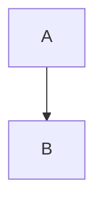

# Code samples

A fenced Rust block, highlighted during the build:

```rust
fn main() {
    let greeting = "hello";
    println!("{greeting}");
}
```

The same language written as an extension:

```rs
fn main() {}
```

JavaScript, resolved by extension:

```js
const answer = 42;
console.log(answer);
```

An unknown language keeps its text and loses the colours:

```foo
a < b && c > d
```

A fence without an info string:

```
plain text
```

A diagram fence is not highlighted; the reader renders it in the browser:



An indented block, which has no language at all:

    indented < code >
